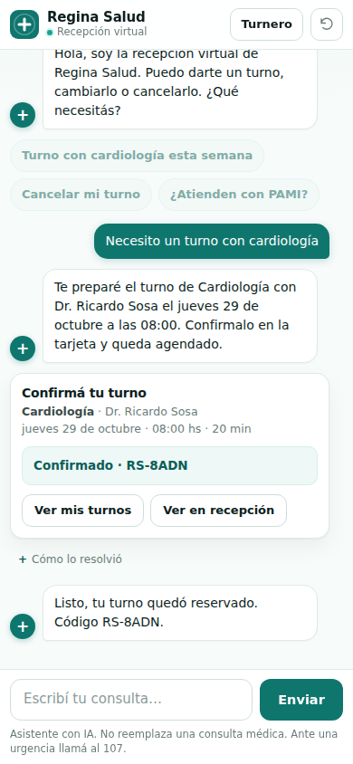

# Recepcionista IA — Regina Salud

Virtual receptionist for the Regina Salud medical centre (Villa Regina, Río Negro). It answers
questions about appointments, checks real availability, and prepares booking, cancellation and
reschedule cards. The language model never writes anything: every change to the appointment book is
applied by the browser, after the patient clicks a button.

The backend talks to one kind of model service: any API compatible with OpenAI
(`POST {base}/chat/completions`), with `deepseek-v4.1-flash` by default. A deterministic offline
model (`RECEPCIONISTA_MODELO=simulado`) drives tests and demos without network or key. There are no
runtime dependencies: Node 22 and its native `fetch` are enough.



```
Browser (asistente.html)                    Server: node src/server.js (:8790)
┌────────────────────────┐   POST /chat    ┌─────────────────────────────────────────────┐
│ chat UI + turnero.js   │ ───────────────►│ guardas → agente (neutral tool-use loop)     │
│ localStorage: rs_turnos│ ◄───────────────│   ↳ herramientas sobre vendor/turnero        │
│ confirm with one click │  text + actions │   ↳ modelo/: openai (fetch) · simulado       │
└────────────────────────┘                 │ registro JSONL · presupuesto del mes + tokens│
                                           └─────────────────────────────────────────────┘
```

## Design rules

1. **The model only proposes; the patient confirms.** Tools return cards (`reservar`, `cancelar`,
   `reprogramar`, `derivar`); the browser applies the change after an explicit click, with the same
   validation the public booking page uses.
2. **Personal data is sanitised before it can travel.** The request carries only the visible chat
   history and an appointment list reduced to `codigo`, `profId`, `fecha`, `hora` and `origen`.
   Name, DNI, phone, insurance and notes have no field to enter and stay in the browser.
3. **The log keeps no content.** One JSON line per request with the hashed IP, model, mode, latency,
   tool names, token counts and cost — never message text or the agenda.
4. **Bounded cost.** Per-IP limits, a monthly USD cap, a daily token cap and a per-turn call limit;
   when any of them trips, the answer degrades to the deterministic fallback instead of calling the
   model.
5. **The key lives only on the server.** The browser never sees it.

## Tools

The model can call these five functions; each validates its input against the schema in
`src/herramientas.js` before touching the agenda, and none of them writes.

| Tool | What it does | Returns |
| --- | --- | --- |
| `buscar_disponibilidad` | Looks for real free slots (up to 6) for a specialty, optional professional, date range and time band. | `slots[]` or a reason. |
| `proponer_reserva` | Revalidates a `slot_id` against the current agenda. | A `reservar` card. |
| `proponer_cancelacion` | Checks that the code exists, was booked from the web and is in the future. | A `cancelar` card. |
| `proponer_reprogramacion` | Same checks plus a free target slot in the same specialty. | A `reprogramar` card. |
| `derivar_a_recepcion` | Handles urgencies, prescriptions, results, billing and anything out of scope. | A `derivar` card (urgency shows 107/911). |

`slot_id` is `<profId>|<YYYY-MM-DD>|<HH:MM>`. A turn is limited to **4 model calls**; past that,
or when the model refuses, hits the output limit or the service is unavailable, the server answers
in fallback mode keeping the cards already prepared.

## Run locally

```bash
npm ci                      # no dependencies; still fixes the tree

# Real model: key and base URL stay on the server.
RECEPCIONISTA_BASE_URL=https://modelo.example/v1 \
RECEPCIONISTA_API_KEY=... \
npm start

# Offline, deterministic model: no network, no key.
RECEPCIONISTA_MODELO=simulado npm start
```

The server prints one line with the port and the model.

To develop the frontend against a static folder:

```bash
RECEPCIONISTA_MODELO=simulado \
RECEPCIONISTA_ESTATICOS=/path/to/site \
RECEPCIONISTA_ORIGENES=http://127.0.0.1:8790 \
RECEPCIONISTA_DATOS=/tmp/recepcionista \
npm start
```

## Configuration

All configuration comes from environment variables; `.env.example` documents every one of them.
`src/config.js` validates and freezes the result, so a bad value falls back to a safe default
instead of crashing.

| Variable | Default | Meaning |
| --- | --- | --- |
| `RECEPCIONISTA_MODELO` | `deepseek-v4.1-flash` | Model id. The value `simulado` selects the offline model. |
| `RECEPCIONISTA_BASE_URL` | *(empty)* | Base URL of the OpenAI-compatible service; calls go to `${base}/chat/completions`. |
| `RECEPCIONISTA_API_KEY` | *(empty)* | Server-side key. Without it (or without the base URL) the service starts in fallback mode. |
| `RECEPCIONISTA_PUERTO` | `8790` | HTTP port. |
| `RECEPCIONISTA_TOPE_USD_MES` | `0.50` | Monthly spending cap in USD, persisted per month. |
| `RECEPCIONISTA_TOPE_TOKENS_DIA` | `3000000` | Daily cap in total tokens (input + output + cache). |
| `RECEPCIONISTA_PRECIO_ENTRADA` / `_SALIDA` | `0.05` / `0.50` | USD per million tokens used to price every response. |
| `RECEPCIONISTA_POR_MINUTO` | `8` | Requests per IP per minute. |
| `RECEPCIONISTA_POR_DIA` | `60` | Requests per IP per rolling 24 hours. |
| `RECEPCIONISTA_CONCURRENCIA` | `4` | Simultaneous model calls. |
| `RECEPCIONISTA_ORIGENES` | *(empty)* | Comma-separated CORS origins. Empty = none. |
| `RECEPCIONISTA_PROXIES_CONFIABLES` | `127.0.0.1,::1,::ffff:127.0.0.1` | Comma-separated IPs or IPv4 CIDRs allowed to send `X-Real-IP`. Empty = no trusted proxy. Malformed entries are ignored; `0.0.0.0/0` trusts everyone, don't use it. |
| `RECEPCIONISTA_DATOS` | `./data` | Folder for the monthly counter and the daily log. |
| `RECEPCIONISTA_SAL` | *(random)* | Salt for the IP hash in logs. Set it to keep hashes stable across restarts. |
| `RECEPCIONISTA_ESTATICOS` | *(empty)* | Development only: static folder served at `/`. |
| `TZ` | forced to `America/Argentina/Buenos_Aires` | The appointment engine works in local time. |

`ia_disponible` is true when the model is simulated, or when both the key and the base URL are set.

The client IP comes from the socket. `X-Real-IP` is honoured only when the socket address is in
`RECEPCIONISTA_PROXIES_CONFIABLES` **and** the header holds a valid IP; otherwise the socket address
wins. IPv4-mapped IPv6 addresses (`::ffff:a.b.c.d`) are normalised to IPv4 before comparing, and the
rate limit plus the hashed IP in the log use that same result.

### Model client

`src/modelo/` implements one neutral interface:

```js
completar({ sistema, herramientas, mensajes })
  → { texto, llamadas: [{ id, nombre, entrada }], fin, uso, extra, crudo }
```

`fin` is `herramientas | fin | rechazo | limite`, `uso` is `{ entrada, salida, cache_w, cache_r }`
and `mensajes` is the neutral format built by `src/agente.js`:

```js
{ rol: 'usuario', texto }                                     // patient turn
{ rol: 'asistente', texto, llamadas, extra }                   // model turn (tools + reasoning)
{ rol: 'resultados', resultados: [{ id, contenido, error }] }  // tool outputs, in order
```

`openai.js` translates to Chat Completions: body `{ model, max_tokens: 2048, messages, tools,
tool_choice: "auto" }`, system prompt first, tools as `{ type: "function", function: { name,
description, parameters } }`. `tool_calls[].function.arguments` arrives as a JSON string and is
parsed with `try/catch`; on failure the call is answered with a recoverable tool error and the
original string is echoed back so the model can fix it. `reasoning_content`, when present, is kept
in `extra` and sent back only in that same assistant message. `finish_reason` maps as
`tool_calls → herramientas`, `stop → fin`, `length → limite`, `content_filter → rechazo`. A 429, a
5xx or a body containing "capacity" gets **one retry after 1.5 s**; if it fails again the client
throws `ModeloNoDisponible` and the turn falls back. 401/403 throw `ModeloAuth` (logged as
`error: "auth"`). The key and the response bodies are never logged; every request has a 30 s
`AbortController` timeout.

`simulado.js` implements the same interface offline: it answers by keywords (urgency, prescriptions,
cancellation, specialty named) and follows the same search → propose script.

## HTTP API

### `POST /api/recepcionista/chat`

```json
{
  "historial": [
    { "rol": "paciente", "texto": "Necesito un turno con cardiología" }
  ],
  "agenda": {
    "turnos": [{ "codigo": "RS-AB12", "profId": "sosa", "fecha": "2026-10-29", "hora": "08:00", "origen": "web" }],
    "gestion": { "sosa|2026-10-29|08:00": { "cancelado": true } }
  }
}
```

```json
{
  "respuesta": "Te preparé el turno de Cardiología con Dr. Ricardo Sosa el jueves 29 de octubre a las 08:00…",
  "acciones": [
    { "tipo": "reservar", "slot": { "espId": "cardiologia", "espNombre": "Cardiología", "profNombre": "Dr. Ricardo Sosa", "fecha": "2026-10-29", "hora": "08:00", "dur": 20 }, "resumen": "…" }
  ],
  "traza": [{ "herramienta": "buscar_disponibilidad", "entrada": { "especialidad": "cardiologia", "…": "…" }, "ok": true }],
  "modo": "ia",
  "ms": 812
}
```

Rules enforced by the server, not by the model:

- `historial` is capped at 12 messages, 600 characters each, 500 for the last one, and must end with
  a patient message.
- `agenda` is sanitised against a whitelist (up to 300 appointments and 300 `gestion` entries).
- Bodies over 32 KB are rejected with `413` and `Connection: close`.
- `503` with `reintentar_en_s` when the concurrency gate is full, `429` with `reintentar_en_s` on
  the per-IP limits, `400` on invalid input.
- The server keeps no conversation state: the browser sends the visible history each time.

### `GET /api/recepcionista/salud`

Health probe used by the frontend and by monitoring. It never reveals the key or the base URL.

```json
{
  "ok": true,
  "modelo": "deepseek-v4.1-flash",
  "ia_disponible": true,
  "presupuesto_mes_pct": 12.5,
  "tokens_dia_pct": 8.1
}
```

## Costs

The cost of each answer is computed from `uso` and the configured prices (USD per million tokens,
`0.05` input / `0.50` output by default). A booking conversation is typically three model calls;
with the simulated model that is 5,400 input, 360 output and 3,600 cached tokens per conversation,
≈ **USD 0.0006** at the default prices.

Two caps stop the spending, whichever comes first:

- **Monthly USD cap** (`RECEPCIONISTA_TOPE_USD_MES`, default `0.50`), persisted in
  `data/presupuesto-YYYY-MM.json`. The month is counted in `America/Argentina/Buenos_Aires`; when it
  changes, a new file starts from zero and the previous one is left untouched.
- **Daily token cap** (`RECEPCIONISTA_TOPE_TOKENS_DIA`, default `3,000,000`). It resets on the first
  request of a new day; the monthly USD total is kept.

`GET /salud` exposes both percentages. Each answer is logged to `data/registro-YYYY-MM-DD.jsonl`
with the hashed IP, model, mode, latency, tool names, token counts and cost — never message text.

## Tests

```bash
npm test          # node --test test/*.test.js
```

107 tests, 0 failures: configuration defaults and the monthly/token budget, sanitisation, limits,
pricing, agenda rules, tool dispatch, prompt, fallback, the simulated model, trusted proxies
(`X-Real-IP` honoured only from configured IPs/CIDRs, malformed entries ignored), the HTTP layer
(CORS, 413, 429, 503) and the model layer. The OpenAI-compatible client is tested with an injected
`fetch` (body shape, string arguments, invalid arguments, `reasoning_content`, ordered `tool`
messages, `finish_reason`, 429 → retry → fallback, 401, no key in logs), and the agent loop runs
end-to-end against both clients to check they produce the same actions.

The script uses the glob `test/*.test.js` on purpose: `node --test test` fails on current Node
releases (`Cannot find module '.../test'`), so the glob keeps `npm test` green while still
discovering every file.

`docs/escenarios.json` lists the conversation scenarios the assistant is expected to handle
(specialty booking, cancellation, urgency, prescriptions, out-of-scope questions) and what should
never happen in each one; it is a checklist for manual or end-to-end runs, not part of `npm test`.

## Deployment

`Dockerfile` builds a non-root image on `node:22-alpine` with `npm ci --omit=dev`, exposes `8790`,
runs `node src/server.js` and keeps all state in `/data` (`RECEPCIONISTA_DATOS=/data`).

```bash
docker build -t recepcionista-ia .
docker run -d --name recepcionista-ia \
  -p 127.0.0.1:8790:8790 \
  -v recepcionista-datos:/data \
  --env-file .env \
  recepcionista-ia
```

`deploy/nginx-location.conf` is a generic `location /api/recepcionista/` block: it proxies to
`127.0.0.1:8790` with `X-Real-IP`, `client_max_body_size 32k`, a 45 s read timeout and
`Cache-Control: no-store`. With nginx on the same host the default trusted proxies (loopback) are
enough; inside Docker with a bridge network add the gateway to
`RECEPCIONISTA_PROXIES_CONFIABLES`, otherwise every visitor shares one rate limit.

Set `RECEPCIONISTA_ORIGENES` to the site origin if the frontend is served from a different host.

## Known limits

- The agenda is the visitor's own `localStorage`: the assistant sees only the appointments saved in
  that browser. A booking made on another device is invisible here, which is deliberate (no personal
  data on the server) but means "cancelá mi turno" only works on the same device.
- Slot availability is revalidated when the card is created and again when the patient confirms, but
  two people can still race for the same slot in the seconds between both steps; the second
  confirmation is rejected with a message.
- There is no authentication on the endpoint: protection is rate limiting, the payload whitelist and
  the caps. A determined attacker can still consume the budget; keep the caps low and monitor
  `/salud`.
- Rate limiting and the in-memory counters are per process. Running several instances behind a load
  balancer needs a shared store.
- The IP hash uses a random salt unless `RECEPCIONISTA_SAL` is set, so hashes change on restart.
- The model can be wrong about administrative details (insurance coverage, preparation
  instructions); the prompt forbids inventing them and routes those cases to a person.
- The client is OpenAI-compatible only: it has no prompt-cache write counter (`cache_w` stays 0) and
  relies on `reasoning_content` for models that return it.
- `vendor/turnero.js` is the same appointment engine that runs in the browser; the assistant and the
  site have to agree on the rules or a card can be rejected on confirmation.

## Resumen en español

Recepción virtual para Regina Salud: un backend chico en Node (sin dependencias, sin Express) que
conversa con el paciente y prepara tarjetas de reserva, cancelación y reprogramación sobre el
turnero que ya usa el sitio.

- Un solo cliente de modelo: API compatible con OpenAI (`POST <base>/chat/completions` con `fetch`
  nativo) y el modelo `deepseek-v4.1-flash` por defecto. `RECEPCIONISTA_MODELO=simulado` levanta un
  modelo falso determinista, sin red ni clave, para demos y pruebas.
- La clave y la URL base viven solo en el servidor. Sin ambas, o al agotarse el presupuesto, el
  servicio responde en modo respaldo con los horarios reales del turnero.
- El modelo no escribe: propone y la persona confirma con un clic, con las mismas validaciones que
  la página pública de turnos.
- Los datos personales nunca viajan al modelo: la agenda se sanea con lista blanca y nombre, DNI,
  celular y obra social se cargan en la tarjeta, en el navegador.
- El costo está acotado por un tope **mensual** en dólares (`data/presupuesto-YYYY-MM.json`, 0.50
  USD por defecto), un tope **diario** de tokens (3.000.000), límites por IP, máximo de 4 llamadas
  por turno y modo respaldo determinista cuando algo se agota o falla.

Para probarlo sin red ni clave: `RECEPCIONISTA_MODELO=simulado npm start`. Las pruebas son
`npm test` (107 casos, todos verdes). El despliegue es el `Dockerfile` de la raíz más el ejemplo de
`deploy/nginx-location.conf`; los límites conocidos están arriba.
